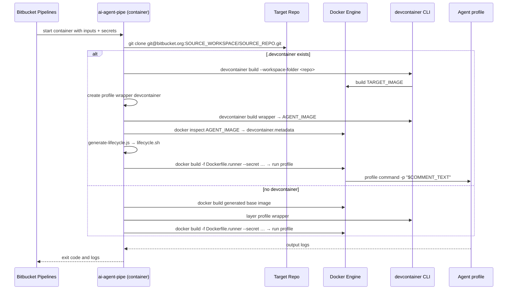

# ai-agent-pipe

A reusable **[Bitbucket Pipe][bb-pipes]** that clones a target repository,
builds its devcontainer when present, layers an AI agent profile on top,
and executes that agent with BuildKit-mounted secrets.

Two profiles ship: `copilot`, which mirrors the working
[ai-agent-hub](https://github.com/FabianSchurig/ai-agent-hub) flow (install
Copilot CLI through a devcontainer feature, configure bb-mcp, replay
devcontainer lifecycle commands, and run Copilot as the devcontainer user),
and `cursor`, which does the same with a pinned `cursor-agent`.

It is designed to be invoked by the
[forge-bitbucket-ai-agent-dispatcher](../README.md) Forge app via the
Bitbucket [on-demand pipelines API][bb-ondemand], so teams do not need to
maintain a separate hub repository or `bitbucket-pipelines.yml`.

The pipe image is published to GitHub Container Registry on every push to
`main` and on every GitHub Release – see
[`../.github/workflows/publish-pipe.yml`](../.github/workflows/publish-pipe.yml).

```
ghcr.io/fabianschurig/forge-bitbucket-ai-agent-dispatcher/ai-agent-pipe:<tag>
```

---

## Architecture



### Two-image rationale

| Image | Built when | Contains | Purpose |
|------|------------|----------|---------|
| **A – runtime** | once, by CI, published to GHCR | `git`, `docker` CLI, `node`, `@devcontainers/cli`, scripts | Orchestration only – kept small |
| **B – agent** | dynamically at runtime, inside the Pipe | Target devcontainer or generated base + selected agent profile + lifecycle replay | Execution; secrets mounted at `docker build` time and never persisted |

---

## Inputs

| Variable | Required | Description |
|---|:--:|---|
| `AGENT_TYPE` |  | Agent profile to run: `copilot` (default) or `cursor`. |
| `AGENT_MODEL` |  | Model override; empty uses the profile's default. |
| `READ_ONLY` |  | `true` gives bb-mcp GET operations only, so the agent reads the pull request and prints its result instead of posting it. |
| `SOURCE_WORKSPACE` | ✅ | Bitbucket workspace slug of the spoke repository. |
| `SOURCE_REPO` | ✅ | Repository slug of the spoke repository. |
| `SOURCE_BRANCH` | ✅ | Branch of the spoke repository to check out. |
| `COMMENT_TEXT` | ✅ | Raw text of the triggering PR comment – used as the agent prompt. |
| `PR_ID` |  | Pull-request numeric ID, so the agent can self-serve PR context through bb-mcp. Without it the run is not about a pull request. |
| `COMMENT_AUTHOR` |  | Atlassian account ID of the comment author (audit only). |
| `AGENT_FEATURE` |  | Devcontainer feature that installs the agent's skills and MCP servers. Defaults to `artifactory-munich.werfen.global:6556/werfen/devcontainer-features/werfen-ai-agent:1`; `none` builds without it. |
| `AGENT_PLUGINS` |  | Marketplace plugins the feature installs. Defaults to `bitbucket`. |
| `DEVCONTAINER_CONFIG` |  | `devcontainer.json` to build, relative to the repository root. Found automatically at `.devcontainer/devcontainer.json`, `.devcontainer.json`, or a single `.devcontainer/<name>/devcontainer.json`; required when there are several. |
| `SOURCE_CLONE_URL` |  | Clone URL; defaults to `git@bitbucket.org:SOURCE_WORKSPACE/SOURCE_REPO.git`. `SSH_KNOWN_HOSTS` adds host keys for another host. |
| `OTEL_EXPORTER_OTLP_ENDPOINT` and friends |  | Turn on tracing of the agent run; see [Tracing with OpenTelemetry](#tracing-with-opentelemetry). |
| `COPILOT_GITHUB_TOKEN` | ✅ 🔒 | For `copilot`: a fine-grained PAT or OAuth token (Copilot ignores anything else). `COPILOT_TOKEN` is accepted as a legacy alias. |
| `CURSOR_API_KEY` | ✅ 🔒 | For `cursor`: a Cursor API key. |
| `BITBUCKET_TOKEN` | ✅ 🔒 | Bitbucket API token used by bb-mcp. With `BITBUCKET_USERNAME` it uses username/token auth; without a username it uses Bearer auth. `BB_TOKEN` is accepted as a legacy alias. |
| `BITBUCKET_USERNAME` | 🔒 | Optional Bitbucket username used with `BITBUCKET_TOKEN` for username/token auth. Omit it to use Bearer auth. `BB_USERNAME` is accepted as a legacy alias. |
| `SSH_KEY` | ✅ 🔒 | Unencrypted SSH private key used to clone the spoke repository, as text or base64 of it. Only needed for an SSH clone URL. |
| `OTEL_EXPORTER_OTLP_HEADERS` | 🔒 | OTLP request headers, typically the collector credential. `OTEL_EXPORTER_OTLP_TRACES_HEADERS` is accepted too. |

> 🔒 = **must** be configured as a *Secured* Bitbucket repository variable
> so it is masked in build logs and only ever materialised on tmpfs at
> runtime. Tokens are never baked into the published image.

The non-secret variable names (`SOURCE_WORKSPACE`, `SOURCE_REPO`, etc.)
match what the Forge dispatcher emits as pipeline variables (see
[`src/ondemandPipelinePayload.ts`](../src/ondemandPipelinePayload.ts)).
Secret variables (the profile's token, `BITBUCKET_TOKEN`,
`SSH_KEY`, and optionally `BITBUCKET_USERNAME`) are **not** sent by the
dispatcher — they must be configured as *Secured* repository or workspace
variables in Bitbucket so they are available at pipeline runtime.

When `BITBUCKET_USERNAME` is configured, bb-mcp receives both username and
token for username/token authentication. When only `BITBUCKET_TOKEN` is
configured, bb-mcp receives the token without a username and uses Bearer
authentication.

---

## Usage

### From the Forge dispatcher

Configure the dispatcher with the `BITBUCKET_ONDEMAND` provider and set
the on-demand YAML to:

```yaml
image: atlassian/default-image:4
pipelines:
  default:
    - step:
        name: Run ai-agent-pipe
        size: 2x
        services: [ docker ]
        script:
          - export DOCKER_BUILDKIT=1
          - pipe: docker://ghcr.io/fabianschurig/forge-bitbucket-ai-agent-dispatcher/ai-agent-pipe:v0.4.0
            variables:
              AGENT_TYPE: copilot   # or cursor, with CURSOR_API_KEY below
              SOURCE_WORKSPACE: $SOURCE_WORKSPACE
              SOURCE_REPO: $SOURCE_REPO
              SOURCE_BRANCH: $SOURCE_BRANCH
              PR_ID: $PR_ID
              COMMENT_TEXT: $COMMENT_TEXT
              COMMENT_AUTHOR: $COMMENT_AUTHOR
              COPILOT_GITHUB_TOKEN: $COPILOT_GITHUB_TOKEN
              # CURSOR_API_KEY: $CURSOR_API_KEY
              BITBUCKET_TOKEN: $BITBUCKET_TOKEN
              # Optional: set BITBUCKET_USERNAME for username/token auth.
              # Omit it to use BITBUCKET_TOKEN as Bearer auth.
              # BITBUCKET_USERNAME: $BITBUCKET_USERNAME
              SSH_KEY: $SSH_KEY

definitions:
  services:
    docker:
      memory: 4096
```

The dispatcher will substitute the dollar-prefixed values from the
pipeline variables it sends with the API request.

### From `bitbucket-pipelines.yml` (manual)

```yaml
pipelines:
  custom:
    run-agent:
      - step:
          name: Run ai-agent-pipe
          size: 2x
          services: [ docker ]
          script:
            - export DOCKER_BUILDKIT=1
            - pipe: docker://ghcr.io/fabianschurig/forge-bitbucket-ai-agent-dispatcher/ai-agent-pipe:latest
              variables:
                AGENT_TYPE: 'copilot'
                SOURCE_WORKSPACE: 'my-workspace'
                SOURCE_REPO: 'my-spoke-repo'
                SOURCE_BRANCH: 'feature/x'
                COMMENT_TEXT: '@agent please fix the failing tests'
                COPILOT_GITHUB_TOKEN: $COPILOT_GITHUB_TOKEN
                BITBUCKET_TOKEN: $BITBUCKET_TOKEN
                # Optional: set BITBUCKET_USERNAME for username/token auth.
                # Omit it to use BITBUCKET_TOKEN as Bearer auth.
                # BITBUCKET_USERNAME: $BITBUCKET_USERNAME
                SSH_KEY: $SSH_KEY

definitions:
  services:
    docker:
      memory: 4096
```

### Local debugging with `docker run`

```bash
docker run --rm \
    -v /var/run/docker.sock:/var/run/docker.sock \
    -e AGENT_TYPE=copilot \
    -e SOURCE_WORKSPACE=my-workspace \
    -e SOURCE_REPO=my-spoke-repo \
    -e SOURCE_BRANCH=main \
    -e COMMENT_TEXT='@agent hello' \
    -e COPILOT_GITHUB_TOKEN \
    -e BITBUCKET_TOKEN \
    -e SSH_KEY="$(cat ~/.ssh/id_ed25519)" \
    ghcr.io/fabianschurig/forge-bitbucket-ai-agent-dispatcher/ai-agent-pipe:latest
```

> The pipe requires a working Docker daemon because the agent image is
> built and executed at runtime. In Bitbucket Pipelines, enable the
> `docker` service, use `size: 2x` for realistic devcontainer builds, and
> allocate at least 4096 MB to the Docker service. Runtime v3 is preferred
> because it supports the BuildKit features this pipe uses.

`pipe/test/pipe-e2e/run.sh` runs the whole image this way, offline, against a
local repository and a stand-in agent profile; CI runs it before every
publish.

---

## File layout

```
pipe/
├── Dockerfile                          # runtime image (Image A)
├── entrypoint.sh                       # input mapping + secret materialisation
├── pipe.yml                            # Bitbucket Pipe metadata
├── README.md                           # this file
├── scripts/
│   ├── run-agent.sh                    # clone + devcontainer build + run
│   ├── provision.sh                    # root-side agent image prep (shared)
│   ├── execute.sh                      # secret-bearing agent invocation (shared)
│   ├── otlp-trace.sh                   # agent stream-json -> OpenTelemetry trace
│   ├── validate-config.sh              # fail-fast input validation
│   └── generate-lifecycle.js           # replay devcontainer lifecycle commands
└── config/
  └── agents/
    ├── copilot/
    │ ├── agent.env               # command, flags, model, secret, paths
    │ ├── copilot-instructions.md # profile instructions copied to ~/.copilot
    │ ├── mcp-config.json         # bb-mcp config template
    │ └── wrapper-devcontainer/
    │   ├── Dockerfile          # layers profile features on $BASE_IMAGE
    │   └── devcontainer.json
    └── cursor/
      ├── agent.env               # command, flags, model, secret, paths
      ├── cursor-instructions.md  # prepended to the prompt
      ├── install.sh              # installs a pinned cursor-agent (provision.sh hook)
      └── mcp-config.json         # bb-mcp config template -> ~/.cursor/mcp.json
test/
├── otlp-trace/run.sh                   # otlp-trace.sh against a recorded stream
└── pipe-e2e/run.sh                     # the whole image, against a local repository
```

`agent.env` is the contract between a profile and the two shared scripts:
`AGENT_SECRET_NAME` names the `/run/secrets/` entry the agent authenticates
with (and the pipe input it comes from, plus any `AGENT_SECRET_ALIASES`), `AGENT_HOME_DIR` / `AGENT_SKILLS_DIR` / `AGENT_MCP_CONFIG_PATH` locate its
files under the container user's home, and an optional `install.sh` puts the
agent CLI on the image when the base image does not already carry it. A
`wrapper-devcontainer/` adds devcontainer features to the agent image; a profile
without one gets a plain wrapper. Any directory under `config/agents/` with an
`agent.env` is a valid `AGENT_TYPE`.

### Skills and MCP servers

The pipe ships no skills. They come from the
[Werfen marketplace](https://bitbucket.org/werfen/marketplace) through the
`werfen-ai-agent` devcontainer feature: `run-agent.sh` adds it to the agent
image with `devcontainer build --additional-features`, the Jenkins shared
library adds it to the base image the same way, and a developer's devcontainer
lists it directly. So a prompt such as "Use the bitbucket-pr-review skill"
behaves the same in all three places. A source repository's own
`.agents/skills/` loads on top and can replace a skill by name.

`execute.sh` merges the profile's `bitbucket` server (token, read-only
configuration) into the MCP config the feature installed, so the other plugin
servers stay available. The feature also installs bb-mcp, so `provision.sh`
only installs it when the base image lacks it.

With `READ_ONLY=true` in the environment, `execute.sh` starts bb-mcp with a
GET-only configuration, so the agent can read the pull request but has no write
operation to call; the prompt tells it to print its result instead.

Both runtimes support both profiles.

### Tracing with OpenTelemetry

`execute.sh` exports nothing unless the agent's environment carries the
standard OpenTelemetry variables. The caller sets them: the Jenkins path passes
them as build args, and the Bitbucket Pipe forwards the ones listed under its
`variables:`, mounting the two `*_HEADERS` as secrets.

| Variable | Effect |
| --- | --- |
| `OTEL_EXPORTER_OTLP_ENDPOINT` | OTLP/HTTP base URL; turns tracing on. `OTEL_EXPORTER_OTLP_TRACES_ENDPOINT` overrides the traces URL. |
| `OTEL_EXPORTER_OTLP_HEADERS` | `k=v,k2=v2` request headers, for example a bearer token. `OTEL_EXPORTER_OTLP_TRACES_HEADERS` overrides them for traces. Values are percent-decoded. |
| `OTEL_SERVICE_NAME`, `OTEL_RESOURCE_ATTRIBUTES` | Service name and resource attributes of the trace. |
| `TRACEPARENT` | W3C trace context, so the agent's trace continues the caller's (for example a CI build step). |

Variables that are set but empty count as unset.

- **Copilot** exports OpenTelemetry natively: an `invoke_agent` root span with
  `chat` (model call) and `execute_tool` children. Content capture stays off
  unless the caller sets `OTEL_INSTRUMENTATION_GENAI_CAPTURE_CONTENT`. Copilot
  only reads the generic endpoint and headers, so `execute.sh` derives them from
  a `.../v1/traces` traces endpoint and traces headers (metrics then go to the
  same collector). Copilot does not export to `http://` endpoints; the log says
  so rather than reporting telemetry as on.
- **Cursor** has no export of its own, so the profile sets
  `AGENT_TRACE_FORMAT=cursor-stream-json` and `execute.sh` pipes the agent's
  output through `scripts/otlp-trace.sh`. It passes the stream through
  unchanged and, at the end of the run, sends one trace: an
  `invoke_agent cursor` root span with model, session, result and token counts,
  plus one `execute_tool <name>` span per tool call with
  `gen_ai.tool.name`, `gen_ai.tool.type`, the MCP server and tool
  (`mcp.server.name`, `mcp.tool.name`) and, for a `skills/<name>/SKILL.md`
  read, `agent.skill.name` and an `agent.skill.invoked` event. Failed and
  unfinished tool calls get an error status. Only metadata is exported:
  prompts, responses, tool arguments and results are never sent.

`otlp-trace.sh` sends OTLP JSON over HTTP, prints the trace id to stderr, and
never fails the run: an unreachable collector is a warning. It also works on
its own, for example in a devcontainer:

```sh
cursor-agent -p "..." --output-format stream-json \
  | OTEL_EXPORTER_OTLP_ENDPOINT=https://otel.example.com otlp-trace.sh
```

`pipe/test/otlp-trace/run.sh` tests it against a recorded stream.

### Reuse from other CI systems

`provision.sh` and `execute.sh` are the agent's actual behaviour, and they are
deliberately independent of this image's entrypoint. Any runtime that can build
a Dockerfile can run the same agent by copying `config/` and `scripts/` out of
this published image and calling the two scripts:

```dockerfile
FROM ghcr.io/fabianschurig/forge-bitbucket-ai-agent-dispatcher/ai-agent-pipe:main AS profile
FROM ${BASE_IMAGE}
COPY --from=profile /usr/local/share/ai-agent-pipe/config /opt/ai-agent/config
COPY --from=profile /usr/local/bin/scripts               /opt/ai-agent/scripts
```

Pin that reference to a digest rather than a tag: it determines the agent's
entire behaviour, and an agent that silently changes between runs is not
something you want to debug.

A Jenkins shared library can drive the agent this way; see ADR
[0002](../docs/adr/0002-jenkins-builds-base-pipe-supplies-profile.md). The pipe
image itself is never executed on that path, because it needs a Docker daemon
and a BuildKit `RUN` cannot bind-mount the Docker socket (ADR
[0001](../docs/adr/0001-buildx-not-docker-run.md)).

`scripts/smoke-test-agent-image/run.sh` exercises exactly this integration
offline, against a stand-in base image and fake tokens.

---

## Security

* The devcontainer configuration and Dockerfile come from the branch under
  review, so nothing they run may reach a secret. `entrypoint.sh` removes the
  secret inputs from the environment before anything else starts, so
  `${localEnv:...}` in a `devcontainer.json` resolves to nothing. The SSH key
  is written to tmpfs for the clone and deleted right after it, before any
  image builds, so a `build.context` pointing outside the repository finds
  nothing either.
* The tokens are written to tmpfs (mode `0600`) only for the final build,
  mounted into its single agent `RUN` with BuildKit `--mount=type=secret`, and
  removed when it ends. They never appear in an image layer or build arg.
* What remains is inherent to running an agent in the branch's own
  environment: the agent `RUN` uses the image that branch defines, so its
  author can see the agent and Bitbucket tokens of a run someone triggers on
  it. Scope `BITBUCKET_TOKEN` to what the agent needs, and trigger runs only
  on branches whose authors you trust with it.
* The publish workflow runs with `permissions: { contents: read,
  packages: write }` – the minimum needed to push to GHCR.
* `entrypoint.sh` never echoes secret values; only variable *names* are
  passed to `validate-config.sh`.
* `run-agent.sh` embeds Bitbucket's published host keys (no runtime
  `ssh-keyscan`) so the clone is MITM-protected without disabling
  `StrictHostKeyChecking`.
* The image's apt sources (Docker, NodeSource) are signed repositories, not
  piped installer scripts, and its base image is pinned by digest.

[bb-pipes]: https://support.atlassian.com/bitbucket-cloud/docs/use-bitbucket-pipes/
[bb-ondemand]: https://developer.atlassian.com/cloud/bitbucket/rest/api-group-pipelines/
